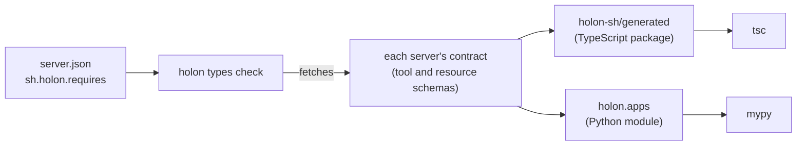
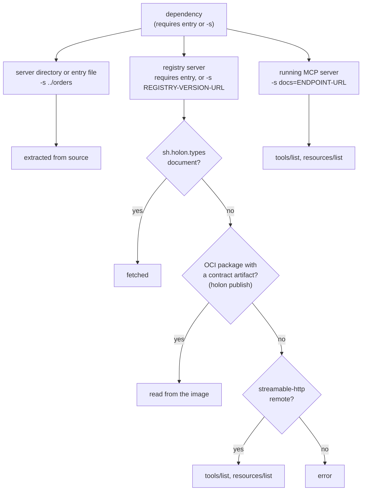

# holon

[](https://github.com/holon-sh/cli/actions/workflows/ci.yml)
[](https://go.dev/doc/install)
[](https://github.com/holon-sh/cli/releases/latest)
[](LICENSE)

`holon` generates typed clients for MCP servers. This allows invoking an MCP server as a function call your type checker understands.

This is currently supported via the [Python SDK](https://github.com/holon-sh/sdk-py) and [TypeScript SDK](https://github.com/holon-sh/sdk-ts).



## Install

```sh
curl -fsSL https://holon-labs.dev/install.sh | sh
```

Or alternatively with [Go](https://go.dev/doc/install) 1.27+, build and install from source:

```sh
go install github.com/holon-sh/cli/cmd/holon@latest
```

## Walkthrough

Declare dependencies under `sh.holon.requires` in your project's [`server.json`](https://modelcontextprotocol.io/registry/quickstart#step-4-create-server-json) ([publisher-provided metadata](https://modelcontextprotocol.io/registry/faq#can-i-add-custom-metadata-when-publishing)).

```json
{
  "name": "io.github.acme/checkout",
  "version": "0.1.0",
  "description": "Checkout service",
  "_meta": {
    "io.modelcontextprotocol.registry/publisher-provided": {
      "sh.holon": {
        "requires": {
          "orders": { "name": "io.github.acme/orders", "version": "1.0.0" }
        }
      }
    }
  }
}
```

Generate the typed clients and type-check the calls to them.

```sh
holon types check
```

Call the server. A wrong tool, argument or result field is a type error.

<details open>
<summary>TypeScript</summary>

```ts
import { apps } from "holon-sh";

const order = await apps.orders.tools.lookup({ id });
order.result;

await apps.orders.tools.lookup({ id: 1 });
// error TS2322: Type 'number' is not assignable to type 'string'.

await apps.orders.tools.lookup({});
// error TS2345: Property '"id"' is missing in type '{}' but required in type '{ id: string; }'.

const total: number = order.total;
// error TS2322: Type 'unknown' is not assignable to type 'number'.
```

</details>

<details>
<summary>Python</summary>

```python
from holon.apps import apps

order = await apps.orders.tools.lookup({"id": id})
order["result"]

await apps.orders.tools.lookup({"id": 1})
# error: Incompatible types (expression has type "int", TypedDict item "id" has type "str")  [typeddict-item]

await apps.orders.tools.lookup({})
# error: Missing key "id" for TypedDict  [typeddict-item]

order["total"]
# error: TypedDict has no key "total"  [typeddict-item]
```

</details>

## Reference

<details open>
<summary><code>holon types generate</code></summary>

```text
Generate typed clients for MCP servers.

Leverages sh.holon.requires in the publisher-provided metadata field
(https://modelcontextprotocol.io/registry/faq#can-i-add-custom-metadata-when-publishing) from
server.json (https://modelcontextprotocol.io/registry/quickstart#step-4-create-server-json) to
resolve dependencies, or the -s list for explicit dependencies.

Usage:
  holon types generate [DIR] [flags]

Examples:
  # Generate for the current project, from server.json requires
  holon types generate

  # Another project
  holon types generate ../checkout

  # Explicit dependencies: a server directory, a server entry, an MCP registry server, a remote
  #   MCP server named docs
  holon types generate -s ../orders
  holon types generate -s ../orders/server.py
  holon types generate -s https://registry.modelcontextprotocol.io/v0.1/servers/io.github.upstash%2Fcontext7/versions/4.4.4
  holon types generate -s docs=https://mcp.context7.com/mcp

  # Print one server's contract
  holon types generate --contract ../orders

Flags:
      --contract string      Print one server's MCP contract instead of generating
  -h, --help                 help for generate
  -s, --server stringArray   A dependency, [ALIAS=]PATH or URL, paths relative to the working
                             directory; repeatable. Without it, server.json requires is used
  -v, --verbose              Show generation details
```

</details>

<details open>
<summary><code>holon types check</code></summary>

```text
Generate typed clients for MCP servers, then type-check the project's calls to them.

Leverages sh.holon.requires in the publisher-provided metadata field
(https://modelcontextprotocol.io/registry/faq#can-i-add-custom-metadata-when-publishing) from
server.json (https://modelcontextprotocol.io/registry/quickstart#step-4-create-server-json) to
resolve dependencies, or the -s list for explicit dependencies.

Usage:
  holon types check [DIR] [flags]

Examples:
  # Generate from server.json requires, then type-check
  holon types check

  # Type-check the existing clients only (no network, no writes)
  holon types check --no-generate

  # Explicit dependencies, as for generate
  holon types check -s orders=../orders

Flags:
  -h, --help                 help for check
      --no-generate          Type-check the existing clients only: no network, no install, no
                             writes
  -s, --server stringArray   A dependency, [ALIAS=]PATH or URL, paths relative to the working
                             directory; repeatable. Without it, server.json requires is used
```

</details>

### Where a dependency's contract comes from


